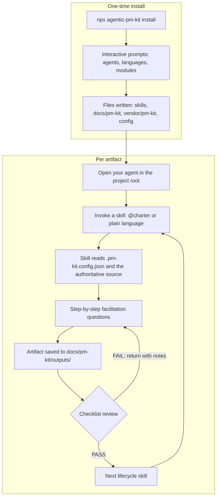
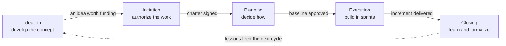

# agentic-pm-kit

`agentic-pm-kit` is a free, MIT-licensed npm package that installs Agent Skills for project-management work into AI-powered CLI tools. Once installed, those skills enable your AI assistant to produce competent drafts of PMBOK- and Scrum-shaped artifacts — charters, risk matrices, sprint plans, retrospectives, and more — directly from your terminal, grounded in authoritative sources rather than hallucinated content.

Supports **Claude Code**, **Gemini CLI** and **OpenCode** out of the box.

---

## Install

### Method 1 — npx (recommended, zero config)

```bash
npx agentic-pm-kit install
```

No global install required. `npx` fetches the package on first run.

> **Note:** `npx` runs the version published on npm, and may serve a cached copy. To force the latest: `npx agentic-pm-kit@latest install`. To run an unpublished local clone instead: `npm install && npm run build && node dist/bin.js install`.

### Method 2 — Claude Code plugin

```bash
/plugin marketplace add Agentic-Engineering-Agency/agentic-pm-kit
/plugin install agentic-pm-kit@agentic-engineering-agency
```

Plugin skills are namespaced (`/agentic-pm-kit:charter`) so they never collide with your standalone skills.

### Method 3 — Gemini CLI extension

```bash
gemini extensions install https://github.com/Agentic-Engineering-Agency/agentic-pm-kit
```

### Method 4 — OpenCode

OpenCode V2 needs no plugin manifest — it auto-discovers skills in `.opencode/skills/`. Run the Method 1 installer and select **OpenCode** as the agent target; skills land in `<project>/.opencode/skills/pm-kit/` and are available the next time you open OpenCode in that project.

Prefer to skip the installer and use a local clone directly? Point OpenCode at the skills tree from your project's `opencode.json(c)`:

```jsonc
{
  "$schema": "https://opencode.ai/config.json",
  "skills": ["./path/to/agentic-pm-kit/skills/pm-kit"],
}
```

Or copy `skills/pm-kit/` into `~/.config/opencode/skills/` for a user-global install shared across projects. Note: the direct-source route installs only the skill files. The installer is the supported path because the skills read `.pm-kit.config.json` (languages, source mode) and `vendor/pm-kit/` (bundled sources) at runtime — both are written by the installer, alongside `docs/pm-kit/` for your outputs.

---

## Quick start (npx path)

install gobal skill: 

1. `cd agentic-pm-kit`

2. `node dist/bin.js install` 

3. `agentic-pm-kit install`

For a single project:

1. `cd` into your project directory.
2. Run `npx agentic-pm-kit install`.
3. Answer the interactive prompts (target dir, agent, language, modules — see below).
4. Confirm the summary screen.
5. Open your AI agent and invoke a skill, e.g. `charter` in Claude Code or `@charter` in OpenCode.

---

## Usage flow



You are the signer of record: every skill produces a draft, and the binary checklist (`docs/pm-kit/checklists/<skill>.md`) gates it. Skills chain in lifecycle order — ideation feeds initiation (charter reads your concept memo), initiation feeds planning, and so on.

---

## What gets installed

The kit ships **40 Agent Skills** across five lifecycle phases:

| Phase          | Skills included                                                                                                 |
| -------------- | --------------------------------------------------------------------------------------------------------------- |
| **Ideation**   | Brainstorming Lab wrapper + 20 PM-curated strategies (Five Whys, Six Thinking Hats, Risk Reversal, and 17 more) |
| **Initiation** | Project Charter, Stakeholder Register, Product Brief                                                            |
| **Planning**   | PRD, WBS, Schedule/Gantt, Cost Estimation, Risk Matrix, Communication Plan, Quality Plan, Resource Plan         |
| **Execution**  | Sprint Planning, Story Execution, Daily Standup Prep, Sprint Review                                             |
| **Closing**    | Sprint Retrospective, Post-Mortem, Project Closure Report                                                       |

Each skill includes a SKILL.md (the agent prompt), a TEMPLATE.md (blank output scaffold), and a CHECKLIST.md (binary acceptance gate). Every artifact skill is grounded in an authoritative source: the Scrum Guide 2020 (bundled), the Agile Manifesto (bundled), or a PMI/ISO canonical URL (linked, open-access version).

### The five phases at a glance



These phases map to the PMBOK process groups (Initiating, Planning, Executing, Monitoring & Controlling, Closing). Ideation is a deliberate pre-project addition, and Monitoring & Controlling is folded into the sprint ceremonies (standup prep, sprint review).

| Phase | What it does | When to use it |
|---|---|---|
| **Ideation** | Turns a vague idea into a developed concept memo via structured brainstorming strategies | At the very start — before any formal paperwork — to stress-test, expand, or reframe a concept |
| **Initiation** | Produces formal authorization: charter, stakeholder register, product brief | A sponsor is ready to commit; the project needs a name, granted authority, and success criteria |
| **Planning** | Produces the "how": PRD, WBS, schedule, cost estimate, risk matrix, and comms/quality/resource plans | The charter is signed and you need a detailed, baselined plan before the team starts building |
| **Execution** | Runs the build loop: sprint planning, story execution, standup prep, sprint review | The team is actively delivering — invoke repeatedly, once per sprint ceremony |
| **Closing** | Captures lessons and formal sign-off: retrospective, post-mortem, closure report | A sprint or the whole project ends; use it before people disperse and knowledge evaporates |

---

## Install destinations

### Claude Code

Skills land in your **project directory**, auto-discovered by Claude Code:

```
<project>/
├── .claude/
│   └── skills/
│       ├── brainstorming-five-whys/SKILL.md
│       ├── charter/SKILL.md
│       └── ... (40 skills)
├── docs/pm-kit/          ← checklists, templates, outputs
├── vendor/pm-kit/        ← bundled Scrum Guide, Manifesto
└── .pm-kit.config.json
```

Per-project install: each project can have its own language, module selection, and config.

### OpenCode

Skills land in your **project directory**, auto-discovered by OpenCode V2 (no config file or manifest needed):

```
<project>/
├── .opencode/
│   └── skills/
│       └── pm-kit/
│           ├── brainstorming-five-whys/SKILL.md
│           ├── charter/SKILL.md
│           └── ... (40 skills)
├── docs/pm-kit/          ← checklists, templates, outputs
├── vendor/pm-kit/        ← bundled Scrum Guide, Manifesto
└── .pm-kit.config.json
```

Per-project install, same as Claude Code. Mention a skill as `@charter` in your prompt, or let the agent load it by ID when relevant.

### Gemini CLI

Skills land in a **user-global extension directory**, auto-discovered on Gemini startup:

```
~/.gemini/
└── extensions/
    └── agentic-pm-kit/
        ├── gemini-extension.json   ← manifest (auto-written)
        └── skills/
            ├── brainstorming-five-whys/SKILL.md
            ├── charter/SKILL.md
            └── ... (40 skills)
```

One install, shared across all your Gemini projects. The per-project artifacts (`docs/pm-kit/`, `vendor/pm-kit/`, `.pm-kit.config.json`) still land in your project directory.

---

## Interactive prompt flow

`npx agentic-pm-kit install` walks you through eight prompts. In multi-select prompts (agents, modules), move with the arrow keys, **toggle with Space**, and confirm with **Enter** — Enter alone submits the current selection without changing it.

1. **Target directory** — default: current working directory.
2. **Project name and description** — stored in `.pm-kit.config.json`.
3. **Agent target** — Claude Code, Gemini CLI, OpenCode, or any combination (default: all three).
4. **Agent communication language** — free-form text; any language string accepted (e.g., `español`, `English`, `português`). Stored verbatim.
5. **Artifact output language** — defaults to the communication language if left blank.
6. **Modules** — multi-select: Ideation, Initiation, Planning, Execution, Closing (default: all).
7. **Brainstorming deck** — Curated 20 (recommended) or Full 60 (includes ~40 non-PM strategies). Also settable via `--full-deck` flag.
8. **Source mode** — Offline (default, bundled sources only) or Online (agent WebFetches canonical URLs). Also settable via `--online-mode` flag.

A summary screen is shown before any files are written.

### Flags

```
npx agentic-pm-kit install --full-deck     # skip deck prompt, install all 60 strategies
npx agentic-pm-kit install --online-mode   # skip source-mode prompt, enable WebFetch
npx agentic-pm-kit --version               # print package version
npx agentic-pm-kit --help                  # print usage
```

### Re-running install

Re-running `npx agentic-pm-kit install` in a directory that already has a `.pm-kit.config.json` refreshes all skill and vendor files to the current package version. Your own output files in `docs/pm-kit/outputs/` are never modified.

---

## Authoritative sources

| Mode                  | Behavior                                                                                                                                                                                                                          |
| --------------------- | --------------------------------------------------------------------------------------------------------------------------------------------------------------------------------------------------------------------------------- |
| **Offline** (default) | Skills use the bundled Scrum Guide 2020 (EN + ES) and Agile Manifesto. For PMBOK concepts, the agent cites named principles and performance domains from general knowledge without fabricating page numbers or direct quotations. |
| **Online** (opt-in)   | Skills additionally instruct the agent to WebFetch the canonical URL for each artifact before drafting. Gives access to public PMI explainers and current Scrum Guide pages. Paywalled PMBOK content remains inaccessible.        |

---

## FAQ

**What language will the output be in?**
Whatever language you typed into the install prompt. The agent reads your `language.output` config and produces all artifacts in that language. You can type any language string — `español`, `English`, `português`, `français`, etc.

**How do I change the language after install?**
Re-run `npx agentic-pm-kit install` and enter the new language when prompted. Your existing output files are not touched.

**How do I uninstall?**
Delete the following paths:

- `.claude/skills/` — remove the skill directories installed by the kit (e.g., `charter/`, `brainstorming-five-whys/`, etc.)
- `.opencode/skills/pm-kit/` (if you installed for OpenCode)
- `~/.gemini/extensions/agentic-pm-kit/` (if you installed for Gemini CLI)
- `docs/pm-kit/`
- `vendor/pm-kit/`
- `.pm-kit.config.json`

**Is my data sent anywhere?**
No. The install is purely local: files are written to your disk from the npm package. There is no telemetry, no account, and no network calls during install (beyond the initial `npx` fetch). Online mode causes your AI agent to make web requests when it runs a skill — that traffic is between your agent and the source websites, not Agentic Engineering Agency.

**Which Node version is required?**
Node 18 or later. Bun 1.0+ also works.

**Does this work with agents other than Claude Code, Gemini CLI and OpenCode?**
Not in v1. The skill format (YAML frontmatter + Markdown body) is based on the shared Agent Skills open standard, so other agents may load the files — but only Claude Code, Gemini CLI and OpenCode are tested and officially supported install targets.

---

## Attribution

Built on open-source methodology from BMad-Method (MIT, © 2025 BMad Code, LLC) — see [THIRD_PARTY_NOTICES.md](./THIRD_PARTY_NOTICES.md).

Bundled vendor content: Scrum Guide 2020 (CC BY-SA 4.0, Ken Schwaber and Jeff Sutherland), Agile Manifesto (© 2001, the signatories). Full attribution in THIRD_PARTY_NOTICES.md.

---

## Documentation

Full playbook and phase-by-phase usage guides:

**<https://labs.agenticengineering.agency/docs/pm-kit>**

---

## License

MIT — see [LICENSE](./LICENSE).
