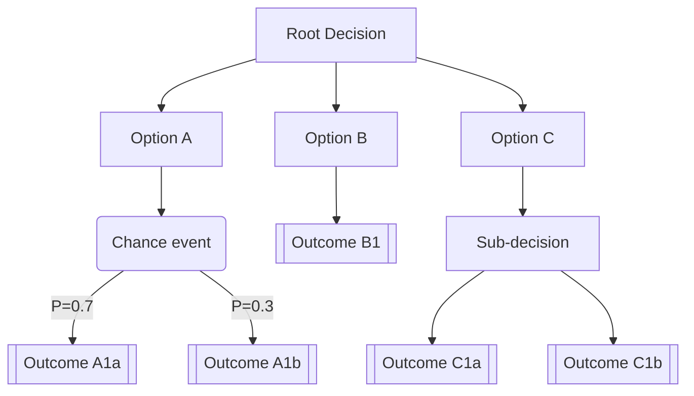

<!-- Generated by agentic-pm-kit:brainstorming-decision-tree-mapping on YYYY-MM-DD -->
<!-- Languages: communication=<value>, output=<value> -->
<!-- Source mode: offline | online -->

# Decision Tree Map

## Root decision

_[State the root decision in one sentence. Confirm the team has agency over this decision.]_

---

## Decision tree

_Render the tree as a Mermaid graph. Replace the example nodes with actual decision branches, chance events, and outcomes from the session. Decision nodes use square brackets, chance events use round brackets, terminal outcomes use double square brackets._

---

## Node inventory

_List every node with its type, label, and any quantitative estimates supplied by the user._

| Node ID | Type | Label | Probability / Impact |
|---|---|---|---|
| root | Decision | _[Root decision label]_ | — |
| A | Decision | _[Option A label]_ | — |
| A1 | Chance | _[Chance event label]_ | _[P= if known]_ |
| A1a | Outcome | _[Outcome label]_ | _[Cost / time / value if known]_ |
| _[Add rows as needed]_ | | | |

---

## Key paths

_Describe the two or three most likely or most consequential paths through the tree._

### Path 1 — _[Short label]_

**Sequence:** _[Root decision] → [Option] → [Chance event] → [Outcome]_
**Probability:** _[Estimated joint probability, or "not quantified"]_
**Impact:** _[Brief description of consequence — cost, time, strategic effect]_

---

### Path 2 — _[Short label]_

**Sequence:** _[Root decision] → [Option] → [Outcome]_
**Probability:** _[Estimated joint probability, or "not quantified"]_
**Impact:** _[Brief description of consequence]_

---

### Path 3 — _[Short label]_ _(if applicable)_

**Sequence:** _[Root decision] → [Option] → [Chance event] → [Outcome]_
**Probability:** _[Estimated joint probability, or "not quantified"]_
**Impact:** _[Brief description of consequence]_

---

## Recommended path

**Favored option:** _[Which first-level branch the team favors]_
**Rationale:** _[One to two sentences explaining why, given the probabilities and impacts documented above.]_
**Next action:** _[What happens immediately after this decision is made — owner and target date.]_

---

## Source consulted

**Canonical reference:** https://kepner-tregoe.com/training/decision-analysis-refresher/
**Mode:** _[offline / online]_
**Note:** _If online mode: confirm the page was fetched and briefly describe what was read. If offline mode: confirm general knowledge of decision tree analysis as described by Kepner-Tregoe was used. Do not fabricate quotations or page numbers._
